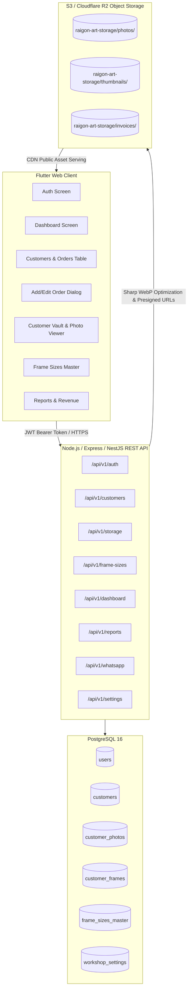

# RAIGON ART - COMPLETE BACKEND REST API & STORAGE SPECIFICATION
**Version:** 2.0.0 (Comprehensive Production Edition)  
**System:** Raigon Art Management System (Flutter Web Application)  
**Target:** 100% Complete Replacement of Firebase (Firestore, Storage, Auth) & Browser LocalStorage  

---

## 1. Complete System Architecture & Overview

This document specifies every single API endpoint, database table, storage flow, and data contract required to power the entire **Raigon Art** application without any reliance on Google Firebase or browser-isolated storage (`SharedPreferences`).

### 1.1 Architecture Diagram


---

## 2. Complete Database Schema (PostgreSQL)

```sql
-- Enable UUID extension
CREATE EXTENSION IF NOT EXISTS "uuid-ossp";

-- 1. USERS & STAFF
CREATE TABLE users (
    id UUID PRIMARY KEY DEFAULT uuid_generate_v4(),
    name VARCHAR(150) NOT NULL,
    email VARCHAR(180) UNIQUE NOT NULL,
    phone VARCHAR(20) UNIQUE NOT NULL,
    password_hash VARCHAR(255) NOT NULL,
    role VARCHAR(20) NOT NULL CHECK (role IN ('admin', 'staff')),
    is_active BOOLEAN NOT NULL DEFAULT true,
    last_login_at TIMESTAMP WITH TIME ZONE,
    created_at TIMESTAMP WITH TIME ZONE DEFAULT CURRENT_TIMESTAMP,
    updated_at TIMESTAMP WITH TIME ZONE DEFAULT CURRENT_TIMESTAMP
);

-- 2. WORKSHOP SETTINGS / PROFILE
CREATE TABLE workshop_settings (
    id VARCHAR(50) PRIMARY KEY DEFAULT 'default',
    business_name VARCHAR(150) NOT NULL DEFAULT 'Raigon Arts',
    tagline VARCHAR(255) DEFAULT 'Photo Frames & Custom Framing',
    business_phone VARCHAR(20) NOT NULL DEFAULT '8137922114',
    business_email VARCHAR(150) DEFAULT 'orders@raigonarts.com',
    workshop_address TEXT NOT NULL DEFAULT 'Main Workshop, MG Road, Trivandrum',
    gstin VARCHAR(50) DEFAULT '',
    business_hours JSONB DEFAULT '[]'::jsonb,
    created_at TIMESTAMP WITH TIME ZONE DEFAULT CURRENT_TIMESTAMP,
    updated_at TIMESTAMP WITH TIME ZONE DEFAULT CURRENT_TIMESTAMP
);

-- 3. FRAME SIZES MASTER CATALOG
CREATE TABLE frame_sizes_master (
    code VARCHAR(30) PRIMARY KEY, -- e.g. 'FS-01'
    name VARCHAR(100) NOT NULL,   -- e.g. '12 × 18 inch'
    width NUMERIC(6, 2) NOT NULL,
    height NUMERIC(6, 2) NOT NULL,
    unit VARCHAR(20) NOT NULL DEFAULT 'Inch',
    category VARCHAR(50) NOT NULL DEFAULT 'Standard',
    orders_count INTEGER NOT NULL DEFAULT 0,
    is_active BOOLEAN NOT NULL DEFAULT true,
    sort_order INTEGER NOT NULL DEFAULT 0,
    created_at TIMESTAMP WITH TIME ZONE DEFAULT CURRENT_TIMESTAMP,
    updated_at TIMESTAMP WITH TIME ZONE DEFAULT CURRENT_TIMESTAMP
);

-- 4. CUSTOMERS & ORDERS
CREATE TABLE customers (
    id VARCHAR(50) PRIMARY KEY, -- e.g. 'RA-1001'
    name VARCHAR(150) NOT NULL,
    city VARCHAR(100) NOT NULL DEFAULT '',
    phone VARCHAR(20) NOT NULL,
    alt_phone VARCHAR(20) DEFAULT '',
    address TEXT NOT NULL DEFAULT '',
    pincode VARCHAR(20) DEFAULT '',
    frame_size_summary VARCHAR(255) NOT NULL DEFAULT '',
    frame_type_summary VARCHAR(255) NOT NULL DEFAULT '',
    qty INTEGER NOT NULL DEFAULT 1,
    total NUMERIC(12, 2) NOT NULL DEFAULT 0.00,
    advance NUMERIC(12, 2) NOT NULL DEFAULT 0.00,
    balance NUMERIC(12, 2) GENERATED ALWAYS AS (total - advance) STORED,
    payment_status VARCHAR(20) NOT NULL DEFAULT 'Unpaid' CHECK (payment_status IN ('Unpaid', 'Partial', 'Paid')),
    status VARCHAR(30) NOT NULL DEFAULT 'pending' CHECK (status IN ('pending', 'inProgress', 'completed', 'cancelled')),
    order_date DATE NOT NULL DEFAULT CURRENT_DATE,
    expected_delivery DATE,
    created_by UUID REFERENCES users(id) ON DELETE SET NULL,
    created_at TIMESTAMP WITH TIME ZONE DEFAULT CURRENT_TIMESTAMP,
    updated_at TIMESTAMP WITH TIME ZONE DEFAULT CURRENT_TIMESTAMP
);

CREATE INDEX idx_customers_phone ON customers(phone);
CREATE INDEX idx_customers_status ON customers(status);
CREATE INDEX idx_customers_payment ON customers(payment_status);
CREATE INDEX idx_customers_order_date ON customers(order_date DESC);

-- 5. CUSTOMER PHOTOS (VAULT)
CREATE TABLE customer_photos (
    id UUID PRIMARY KEY DEFAULT uuid_generate_v4(),
    customer_id VARCHAR(50) NOT NULL REFERENCES customers(id) ON DELETE CASCADE,
    file_name VARCHAR(255) NOT NULL,
    file_url VARCHAR(500) NOT NULL,
    thumbnail_url VARCHAR(500),
    file_size_bytes INTEGER NOT NULL,
    mime_type VARCHAR(100) NOT NULL DEFAULT 'image/jpeg',
    sort_order INTEGER NOT NULL DEFAULT 0,
    created_at TIMESTAMP WITH TIME ZONE DEFAULT CURRENT_TIMESTAMP
);

CREATE INDEX idx_customer_photos_customer ON customer_photos(customer_id);

-- 6. CUSTOMER FRAME SPECIFICATIONS
CREATE TABLE customer_frames (
    id UUID PRIMARY KEY DEFAULT uuid_generate_v4(),
    customer_id VARCHAR(50) NOT NULL REFERENCES customers(id) ON DELETE CASCADE,
    size VARCHAR(100) NOT NULL,
    unit VARCHAR(20) NOT NULL DEFAULT 'Inch',
    custom_width VARCHAR(20) DEFAULT '',
    custom_height VARCHAR(20) DEFAULT '',
    frame_type VARCHAR(100) NOT NULL DEFAULT '',
    material VARCHAR(100) NOT NULL DEFAULT '',
    finish VARCHAR(100) NOT NULL DEFAULT '',
    orientation VARCHAR(50) NOT NULL DEFAULT '',
    qty INTEGER NOT NULL DEFAULT 1,
    notes TEXT DEFAULT '',
    photo_name VARCHAR(255),
    photo_url VARCHAR(500),
    created_at TIMESTAMP WITH TIME ZONE DEFAULT CURRENT_TIMESTAMP
);

CREATE INDEX idx_customer_frames_customer ON customer_frames(customer_id);

-- 7. AUDIT & ACTIVITY LOGS
CREATE TABLE activity_logs (
    id UUID PRIMARY KEY DEFAULT uuid_generate_v4(),
    customer_id VARCHAR(50) REFERENCES customers(id) ON DELETE SET NULL,
    user_id UUID REFERENCES users(id) ON DELETE SET NULL,
    action VARCHAR(50) NOT NULL, -- e.g. 'CREATED', 'STATUS_CHANGE', 'PAYMENT_RECEIVED'
    details JSONB NOT NULL DEFAULT '{}'::jsonb,
    created_at TIMESTAMP WITH TIME ZONE DEFAULT CURRENT_TIMESTAMP
);
```

---

## 3. Comprehensive REST API Endpoints Specification

### MODULE 1: AUTHENTICATION & STAFF MANAGEMENT

#### 1.1 Login (Email or Phone)
* **Endpoint:** `POST /api/v1/auth/login`
* **Access:** Public
* **Request:**
```json
{
  "identifier": "admin@gmail.com", // Or phone number "8137922114"
  "password": "securePassword123"
}
```
* **Response (200 OK):**
```json
{
  "success": true,
  "data": {
    "token": "eyJhbGciOiJIUzI1NiIsInR5cCI6IkpXVCJ9...",
    "refreshToken": "d8293f9a-1123-45ef...",
    "user": {
      "id": "e4b17b62-6029-4d64-83b1-3e4b3c076591",
      "name": "Raigon Admin",
      "email": "admin@gmail.com",
      "phone": "8137922114",
      "role": "admin"
    }
  }
}
```

#### 1.2 Send WhatsApp / SMS OTP
* **Endpoint:** `POST /api/v1/auth/forgot-password`
* **Request:** `{ "phone": "8137922114" }`
* **Response (200 OK):**
```json
{
  "success": true,
  "message": "OTP sent to registered WhatsApp number."
}
```

#### 1.3 Verify OTP
* **Endpoint:** `POST /api/v1/auth/verify-otp`
* **Request:** `{ "phone": "8137922114", "otp": "1234" }`
* **Response (200 OK):**
```json
{
  "success": true,
  "resetToken": "otp_verified_token_9934"
}
```

#### 1.4 Reset Password
* **Endpoint:** `POST /api/v1/auth/reset-password`
* **Request:**
```json
{
  "phone": "8137922114",
  "resetToken": "otp_verified_token_9934",
  "newPassword": "newSecretPassword123"
}
```
* **Response (200 OK):** `{ "success": true, "message": "Password updated successfully." }`

#### 1.5 Get Current Profile
* **Endpoint:** `GET /api/v1/auth/me`
* **Headers:** `Authorization: Bearer <token>`
* **Response (200 OK):**
```json
{
  "success": true,
  "data": {
    "id": "e4b17b62-6029-4d64-83b1-3e4b3c076591",
    "name": "Raigon Admin",
    "email": "admin@gmail.com",
    "phone": "8137922114",
    "role": "admin"
  }
}
```

#### 1.6 Refresh Access Token
* **Endpoint:** `POST /api/v1/auth/refresh`
* **Request:** `{ "refreshToken": "d8293f9a-1123-45ef..." }`

---

### MODULE 2: CUSTOMERS & ORDER MANAGEMENT

#### 2.1 Get All Customers (with Filters, Search, and Pagination)
* **Endpoint:** `GET /api/v1/customers`
* **Query Parameters:**
  * `search` *(string)*: Matches Customer ID (`RA-1001`), Name, or Phone.
  * `status` *(string)*: `pending`, `inProgress`, `completed`, `cancelled`.
  * `paymentStatus` *(string)*: `Unpaid`, `Partial`, `Paid`.
  * `startDate` *(ISO date)*: Filter by `order_date >= startDate`.
  * `endDate` *(ISO date)*: Filter by `order_date <= endDate`.
  * `page` *(int, default: 1)*
  * `limit` *(int, default: 10)*
  * `sortBy` *(string, default: "orderDate")*
  * `sortOrder` *(string, default: "desc")*
* **Response (200 OK):**
```json
{
  "success": true,
  "meta": {
    "total": 56,
    "page": 1,
    "limit": 10,
    "totalPages": 6,
    "statusCounts": {
      "all": 56,
      "pending": 10,
      "inProgress": 22,
      "completed": 20,
      "cancelled": 4
    }
  },
  "data": [
    {
      "id": "RA-1001",
      "name": "Ananthu Krishnan",
      "city": "Trivandrum",
      "phone": "9876543210",
      "altPhone": "9876543211",
      "address": "TC 14/230, Kowdiar, Trivandrum",
      "pincode": "695003",
      "photoCount": 2,
      "photoNames": ["Family_Portrait.jpg", "Painting.jpg"],
      "photoUrls": [
        "https://cdn.raigonart.com/customers/RA-1001/photos/Family_Portrait.webp",
        "https://cdn.raigonart.com/customers/RA-1001/photos/Painting.webp"
      ],
      "photoSizeLabels": ["2.4 MB", "3.1 MB"],
      "frameSize": "12 × 18 inch",
      "frameType": "Teak Wood Moulding",
      "qty": 2,
      "total": 4500,
      "advance": 2000,
      "balance": 2500,
      "paymentStatus": "Partial",
      "status": "inProgress",
      "orderDate": "2026-10-15T00:00:00.000Z",
      "expectedDelivery": "2026-10-22T00:00:00.000Z",
      "frames": [
        {
          "id": "f1837482-9428-4ef3-8419-f01837264819",
          "size": "12 × 18 inch",
          "unit": "Inch",
          "customWidth": "",
          "customHeight": "",
          "frameType": "Teak Wood Moulding",
          "material": "Teak Wood Moulding",
          "finish": "Walnut Brown",
          "orientation": "Landscape (Horizontal)",
          "qty": 2,
          "notes": "Anti-glare acrylic sheet required",
          "photoName": "Family_Portrait.jpg",
          "photoUrl": "https://cdn.raigonart.com/customers/RA-1001/frames/frame_1.webp"
        }
      ]
    }
  ]
}
```

#### 2.2 Get Single Customer Details by ID
* **Endpoint:** `GET /api/v1/customers/:id`
* **Response (200 OK):** Full single customer JSON (including all photos and frame specs).

#### 2.3 Create New Customer (Multipart with Direct Image Upload)
* **Endpoint:** `POST /api/v1/customers`
* **Content-Type:** `multipart/form-data`
* **Form-Data Parts:**
  * `customerData` *(Text/JSON)*:
    ```json
    {
      "id": "RA-1002",
      "name": "Deepa Varma",
      "city": "Ernakulam",
      "phone": "9447112233",
      "altPhone": "",
      "address": "Panampilly Nagar, Kochi",
      "pincode": "682036",
      "total": 3200,
      "advance": 3200,
      "paymentStatus": "Paid",
      "status": "pending",
      "orderDate": "2026-10-16T00:00:00.000Z",
      "expectedDelivery": "2026-10-24T00:00:00.000Z",
      "frames": [
        {
          "size": "8 × 12 inch",
          "unit": "Inch",
          "customWidth": "",
          "customHeight": "",
          "frameType": "Minimalist Matte Black",
          "material": "Synthetic Moulding",
          "finish": "Matte Black",
          "orientation": "Portrait (Vertical)",
          "qty": 1,
          "notes": "Include white mount 1.5 inch",
          "photoName": "deepa_art.jpg"
        }
      ]
    }
    ```
  * `photos` *(File array)*: Binary image files for vault.
  * `frame_photos` *(File array, optional)*: Specific individual frame images.
* **Server Action:**
  1. Compresses images using `sharp` (JPEG/PNG to WebP, 85% quality, strip EXIF metadata).
  2. Generates 300px thumbnail versions for fast grid display.
  3. Uploads to S3 / Cloudflare R2 bucket (`raigon-art-storage/customers/RA-1002/`).
  4. Inserts row into `customers`, `customer_photos`, and `customer_frames`.
* **Response (201 Created):** Full created customer object with CDN URLs.

#### 2.4 Update Customer
* **Endpoint:** `PUT /api/v1/customers/:id`
* **Content-Type:** `multipart/form-data` (or `application/json` if no new files)
* **Response (200 OK):** Updated customer record.

#### 2.5 Quick Order Status Change (Dashboard / Table Action)
* **Endpoint:** `PATCH /api/v1/customers/:id/status`
* **Request:** `{ "status": "completed" }`
* **Response (200 OK):**
```json
{
  "success": true,
  "id": "RA-1001",
  "status": "completed",
  "updatedAt": "2026-10-16T12:00:00.000Z"
}
```

#### 2.6 Quick Payment Update
* **Endpoint:** `PATCH /api/v1/customers/:id/payment`
* **Request:**
```json
{
  "advance": 4500,
  "paymentStatus": "Paid"
}
```
* **Response (200 OK):** Returns updated `advance`, `balance`, and `paymentStatus`.

#### 2.7 Delete Customer
* **Endpoint:** `DELETE /api/v1/customers/:id`
* **Server Action:** Cascades delete in database AND permanently deletes customer files from S3/R2 storage.
* **Response (200 OK):** `{ "success": true, "message": "Customer RA-1001 deleted." }`

#### 2.8 Get Next Order ID
* **Endpoint:** `GET /api/v1/customers/next-id`
* **Response (200 OK):** `{ "success": true, "nextId": "RA-1057" }`

---

### MODULE 3: STORAGE & PHOTO VAULT MANAGEMENT

#### 3.1 Standalone Photo Upload
* **Endpoint:** `POST /api/v1/storage/upload`
* **Content-Type:** `multipart/form-data` (`file`)
* **Response (200 OK):**
```json
{
  "success": true,
  "data": {
    "fileName": "landscape.jpg",
    "fileUrl": "https://cdn.raigonart.com/photos/landscape.webp",
    "thumbnailUrl": "https://cdn.raigonart.com/thumbnails/landscape_thumb.webp",
    "sizeBytes": 1420500,
    "mimeType": "image/webp"
  }
}
```

#### 3.2 Bulk Download Order Photos as ZIP
*Printing and production staff frequently need all original high-resolution photos for an order in one click.*
* **Endpoint:** `GET /api/v1/customers/:id/photos/download-zip`
* **Response:** Streaming `application/zip` file with filename `${customerId}_photos.zip`.

#### 3.3 Delete Specific Photo
* **Endpoint:** `DELETE /api/v1/customers/:id/photos/:photoId`
* **Response (200 OK):** `{ "success": true, "message": "Photo deleted." }`

---

### MODULE 4: FRAME SIZES MASTER CATALOG

#### 4.1 List Frame Sizes
* **Endpoint:** `GET /api/v1/frame-sizes`
* **Query Parameters:** `activeOnly=true|false`
* **Response (200 OK):**
```json
{
  "success": true,
  "data": [
    {
      "code": "FS-01",
      "name": "4 × 6 inch",
      "width": 4.0,
      "height": 6.0,
      "unit": "Inch",
      "category": "Standard",
      "orders": 14,
      "active": true
    },
    {
      "code": "FS-02",
      "name": "5 × 7 inch",
      "width": 5.0,
      "height": 7.0,
      "unit": "Inch",
      "category": "Standard",
      "orders": 28,
      "active": true
    },
    {
      "code": "FS-03",
      "name": "8 × 10 inch",
      "width": 8.0,
      "height": 10.0,
      "unit": "Inch",
      "category": "Standard",
      "orders": 35,
      "active": true
    },
    {
      "code": "FS-04",
      "name": "12 × 18 inch",
      "width": 12.0,
      "height": 18.0,
      "unit": "Inch",
      "category": "Standard",
      "orders": 42,
      "active": true
    }
  ]
}
```

#### 4.2 Add Frame Size
* **Endpoint:** `POST /api/v1/frame-sizes`
* **Request:**
```json
{
  "code": "FS-05",
  "name": "16 × 24 inch",
  "width": 16.0,
  "height": 24.0,
  "unit": "Inch",
  "category": "Standard",
  "active": true
}
```

#### 4.3 Update Frame Size
* **Endpoint:** `PUT /api/v1/frame-sizes/:code`

#### 4.4 Delete Frame Size
* **Endpoint:** `DELETE /api/v1/frame-sizes/:code`

---

### MODULE 5: DASHBOARD & ANALYTICS

#### 5.1 Dashboard Summary Statistics
* **Endpoint:** `GET /api/v1/dashboard/stats`
* **Response (200 OK):**
```json
{
  "success": true,
  "data": {
    "totalCustomers": 142,
    "totalRevenue": 482500,
    "totalAdvance": 380000,
    "pendingBalance": 102500,
    "statusCounts": {
      "pending": 18,
      "inProgress": 35,
      "completed": 82,
      "cancelled": 7
    },
    "recentOrders": [
      {
        "id": "RA-1042",
        "name": "Vinod Kumar",
        "phone": "9847012345",
        "frameSize": "12 × 18 inch",
        "frameType": "Teak Wood Moulding",
        "qty": 1,
        "total": 3500,
        "status": "pending",
        "orderDate": "2026-10-16T00:00:00.000Z"
      }
    ]
  }
}
```

---

### MODULE 6: REPORTS & EXPORT

#### 6.1 Revenue & Sales Report
* **Endpoint:** `GET /api/v1/reports/summary`
* **Query Parameters:** `period=month1|month2|allTime`
* **Response (200 OK):**
```json
{
  "success": true,
  "data": {
    "period": "month1",
    "orderCount": 42,
    "grossSales": 164000,
    "advanceCollected": 128000,
    "outstandingBalance": 36000,
    "topSellingSizes": [
      { "size": "12 × 18 inch", "count": 18, "revenue": 63000 },
      { "size": "8 × 10 inch", "count": 14, "revenue": 39200 }
    ],
    "statusBreakdown": {
      "completed": 28,
      "inProgress": 10,
      "pending": 4
    }
  }
}
```

#### 6.2 Export All Customers to CSV
* **Endpoint:** `GET /api/v1/customers/export/csv`
* **Response:** `Content-Type: text/csv` (Downloadable CSV spreadsheet with BOM for Excel compatibility).

#### 6.3 Generate Customer Order PDF / Invoice
* **Endpoint:** `GET /api/v1/customers/:id/invoice`
* **Response:** `Content-Type: application/pdf` with print-ready invoice.

---

### MODULE 7: WHATSAPP AUTOMATION & NOTIFICATIONS

#### 7.1 Send Order Confirmation WhatsApp Message
* **Endpoint:** `POST /api/v1/whatsapp/send-order-confirmation`
* **Request:** `{ "customerId": "RA-1001" }`
* **Response (200 OK):**
```json
{
  "success": true,
  "messageId": "wamid.HBgLOTE...",
  "status": "sent"
}
```

#### 7.2 Send Status Update (Ready for Pickup / Out for Delivery)
* **Endpoint:** `POST /api/v1/whatsapp/send-status-update`
* **Request:**
```json
{
  "customerId": "RA-1001",
  "status": "completed",
  "customNote": "Your frames are packed and ready for pickup at our MG Road workshop!"
}
```

---

### MODULE 8: WORKSHOP PROFILE & SETTINGS

#### 8.1 Get Workshop Profile
* **Endpoint:** `GET /api/v1/settings/profile`
* **Response (200 OK):**
```json
{
  "success": true,
  "data": {
    "businessName": "Raigon Arts",
    "tagline": "Photo Frames & Custom Framing",
    "businessPhone": "8137922114",
    "businessEmail": "orders@raigonarts.com",
    "workshopAddress": "Main Workshop, MG Road, Trivandrum",
    "gstin": "32AAAAA0000A1Z5",
    "businessHours": [
      { "day": "Monday - Saturday", "hours": "9:30 AM – 8:00 PM" },
      { "day": "Sunday", "hours": "Closed" }
    ]
  }
}
```

#### 8.2 Update Workshop Profile
* **Endpoint:** `PUT /api/v1/settings/profile`

---

## 4. Complete Endpoint Summary Matrix

| # | Method | Endpoint | Description | Replaces |
|:---|:---|:---|:---|:---|
| 1 | `POST` | `/api/v1/auth/login` | Staff / Admin JWT login | `FirebaseAuth.signInWithEmailAndPassword` |
| 2 | `POST` | `/api/v1/auth/forgot-password` | Request password reset OTP | Mock OTP |
| 3 | `POST` | `/api/v1/auth/verify-otp` | Verify WhatsApp OTP | Mock OTP |
| 4 | `POST` | `/api/v1/auth/reset-password` | Update password | Mock reset |
| 5 | `GET`  | `/api/v1/auth/me` | Fetch logged-in user profile | `FirebaseAuth.currentUser` |
| 6 | `GET`  | `/api/v1/customers` | Paginated customer list with filters | `Firestore.collection('customers').get()` |
| 7 | `GET`  | `/api/v1/customers/:id` | Single customer details + photos | `Firestore.doc(id)` |
| 8 | `POST` | `/api/v1/customers` | Create customer + upload photos | `Firestore.set()` + `SharedPreferences` |
| 9 | `PUT`  | `/api/v1/customers/:id` | Update customer & photos | `Firestore.update()` |
| 10| `PATCH`| `/api/v1/customers/:id/status` | Quick status change | In-memory status override |
| 11| `PATCH`| `/api/v1/customers/:id/payment` | Record payment / advance | In-memory payment update |
| 12| `DELETE`| `/api/v1/customers/:id` | Delete customer & clean S3 files | `Firestore.delete()` |
| 13| `GET`  | `/api/v1/customers/next-id` | Next serial ID (`RA-1043`) | Client-side ID generation |
| 14| `GET`  | `/api/v1/customers/export/csv` | Download CSV spreadsheet | Client-side CSV generator |
| 15| `GET`  | `/api/v1/customers/:id/invoice`| Download invoice PDF | Client-side PDF generator |
| 16| `POST` | `/api/v1/storage/upload` | Direct image upload | Browser `localStorage` Base64 |
| 17| `GET`  | `/api/v1/customers/:id/photos/download-zip` | Bulk download order photos | N/A (New feature) |
| 18| `GET`  | `/api/v1/frame-sizes` | Fetch frame catalog | `prefs.getString('raigon_frame_sizes')` |
| 19| `POST` | `/api/v1/frame-sizes` | Add frame size | `prefs.setString('raigon_frame_sizes')` |
| 20| `PUT`  | `/api/v1/frame-sizes/:code` | Update frame size | `prefs.setString('raigon_frame_sizes')` |
| 21| `DELETE`| `/api/v1/frame-sizes/:code`| Remove frame size | `prefs.setString('raigon_frame_sizes')` |
| 22| `GET`  | `/api/v1/dashboard/stats` | Dashboard KPIs & metrics | Computed on client from all docs |
| 23| `GET`  | `/api/v1/reports/summary` | Revenue & sales report | Computed on client from all docs |
| 24| `POST` | `/api/v1/whatsapp/send-order-confirmation` | Automated WhatsApp message | `url_launcher` `wa.me` URL |
| 25| `GET`  | `/api/v1/settings/profile` | Workshop profile details | Hardcoded constants in `ProfileScreen` |

---

## 5. Flutter Client Integration Architecture

### 5.1 Updated `CustomerRepository` (`HttpCustomerRepository`)
```dart
import 'dart:convert';
import 'package:http/http.dart' as http;
import 'package:raigon_art/features/customers/models/customer_model.dart';
import 'package:raigon_art/features/customers/repository/customer_repository.dart';

class HttpCustomerRepository implements CustomerRepository {
  HttpCustomerRepository({required this.baseUrl, this.token});

  final String baseUrl;
  final String? token;

  Map<String, String> get _headers => {
    'Accept': 'application/json',
    if (token != null) 'Authorization': 'Bearer $token',
  };

  @override
  Future<List<Customer>> getAll() async {
    final response = await http.get(
      Uri.parse('$baseUrl/api/v1/customers?limit=100'),
      headers: _headers,
    );

    if (response.statusCode != 200) {
      throw Exception('Failed to load customers: ${response.body}');
    }

    final json = jsonDecode(response.body);
    final list = json['data'] as List<dynamic>;

    return list
        .map((item) => Customer.fromJson(Map<String, dynamic>.from(item as Map)))
        .toList();
  }

  @override
  Future<void> upsert(Customer customer) async {
    final uri = Uri.parse('$baseUrl/api/v1/customers');
    final request = http.MultipartRequest('POST', uri);
    request.headers.addAll(_headers);

    // 1. Send text metadata as JSON
    final jsonMeta = customer.toJson()
      ..remove('photoBytes'); // Clean up bytes before sending
    request.fields['customerData'] = jsonEncode(jsonMeta);

    // 2. Attach newly picked photos
    for (var i = 0; i < customer.photoBytes.length; i++) {
      final name = i < customer.photoNames.length
          ? customer.photoNames[i]
          : 'photo_$i.jpg';

      request.files.add(
        http.MultipartFile.fromBytes('photos', customer.photoBytes[i], filename: name),
      );
    }

    final streamed = await request.send();
    final response = await http.Response.fromStream(streamed);

    if (response.statusCode >= 300) {
      throw Exception('Failed to save customer: ${response.body}');
    }
  }

  @override
  Future<void> delete(String id) async {
    final response = await http.delete(
      Uri.parse('$baseUrl/api/v1/customers/$id'),
      headers: _headers,
    );

    if (response.statusCode != 200) {
      throw Exception('Failed to delete customer: ${response.body}');
    }
  }
}
```
